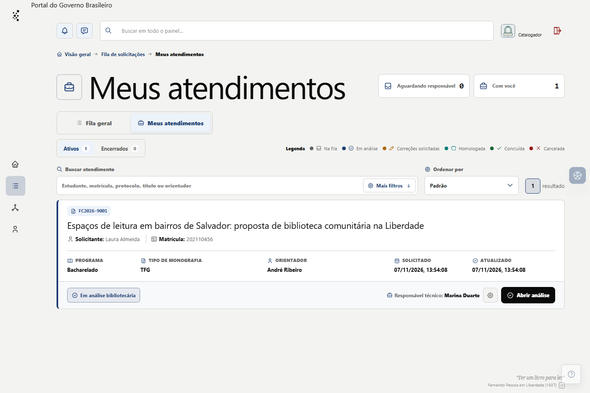
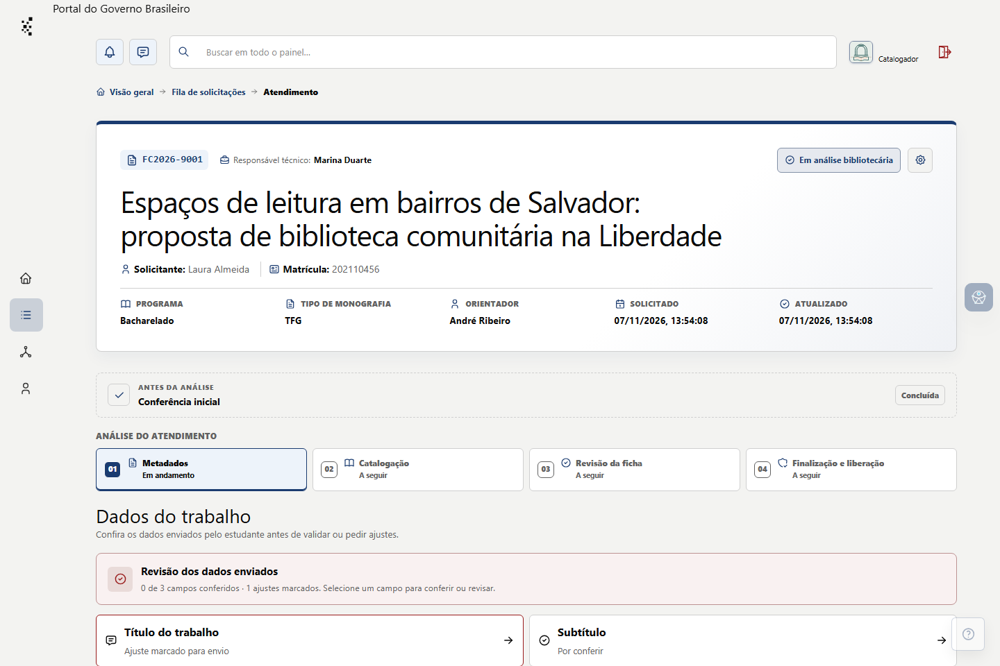
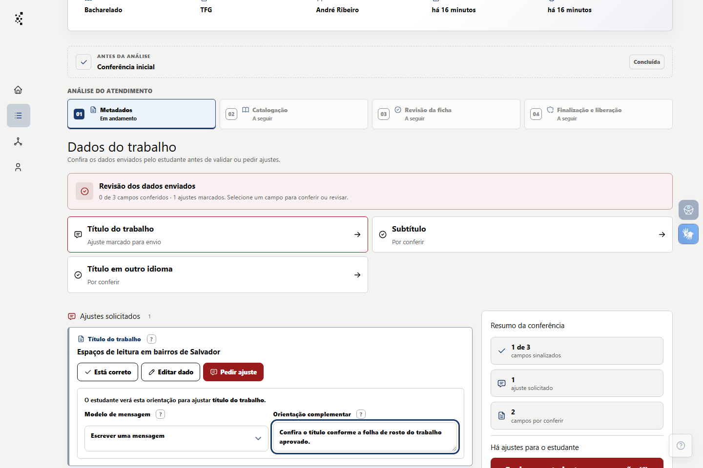
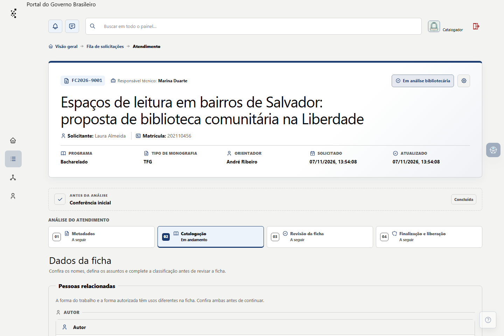
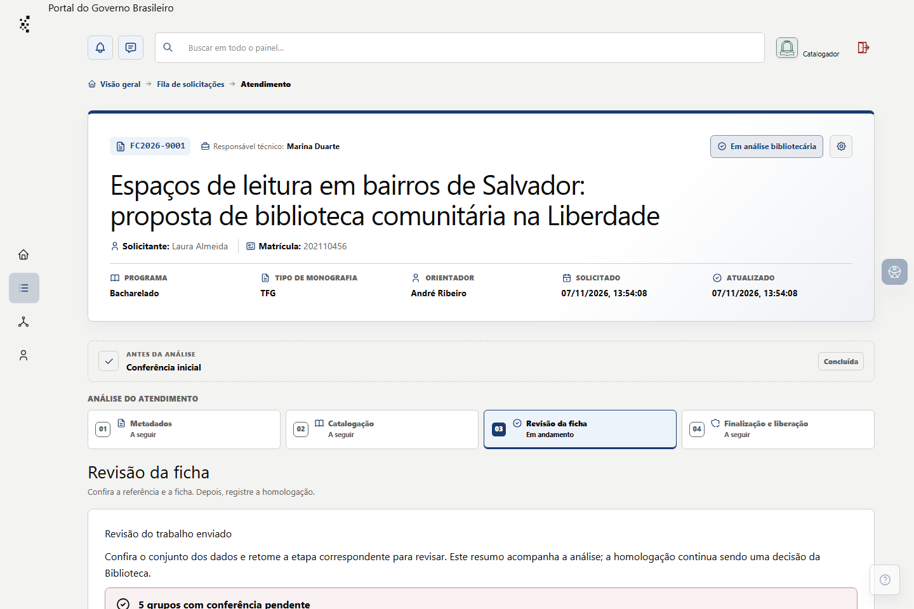
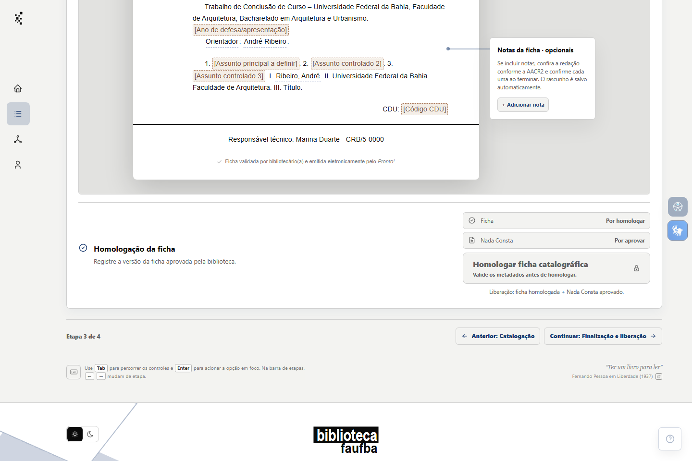
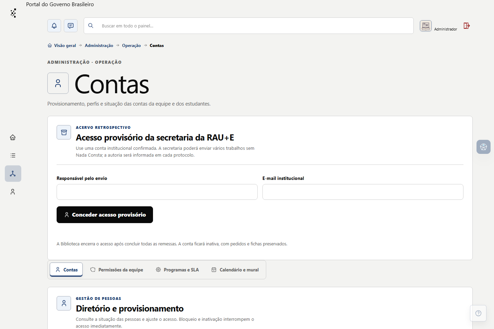
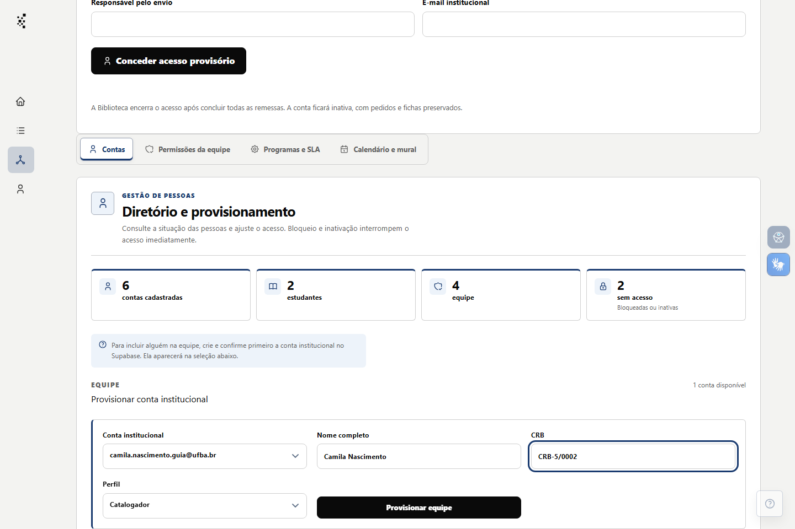
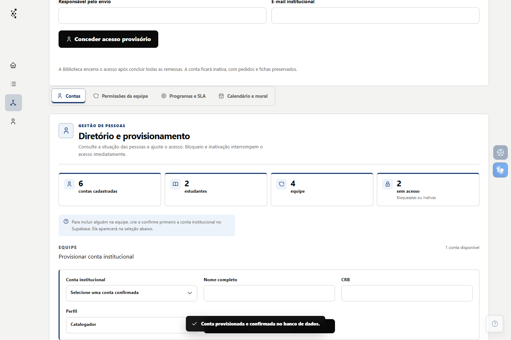

# Guia da equipe — piloto editorial

Rascunho de 07/11/2026, baseado no código da `master` que inclui o PR #25. **Não publicado.** A interface editável do guia e sua migração estão preparadas apenas no código local; os capítulos abaixo ainda não foram transferidos para o editor nem implantados no servidor. As imagens abaixo foram capturadas no Pronto! local, em 1440 × 960, com nomes de pessoas, matrícula, CRB e trabalho plausíveis, porém inventados. Os nomes não representam pessoas reais da equipe. O endereço do arquivo usa o domínio reservado `.example`; a conferência inicial foi posicionada como concluída no banco fictício somente para mostrar as etapas seguintes. Isso não comprova acesso a um PDF nem validação bibliotecária. Os procedimentos institucionais e as capturas devem ser conferidos pela BIB/FAUFBA antes de entrar no painel. Este documento não autoriza mudança de regras nem operação no banco remoto.

## Como o guia será apresentado

- Entrada própria **Guia da equipe** no painel, fora da Central pública `/ajuda`.
- Conteúdo para catalogadores e administradores ativos conforme as permissões efetivas. O guia administrativo só aparece a quem pode executar ou consultar a tarefa correspondente.
- Cada procedimento reúne objetivo, condições para começar, uma tabela inicial dos elementos da interface usados na tarefa (rótulo e ícone oficiais quando houver, mais descrição), passos com rótulos reais, resultado esperado, impedimentos comuns e capturas. Se passar por várias telas, a tabela identifica onde cada elemento aparece. A ajuda contextual aponta diretamente para o procedimento pertinente.
- Na versão publicada, as capturas ficarão em bucket privado, com leitura autorizada pela conta ativa. As imagens deste rascunho permanecem apenas nos arquivos de trabalho. Não usar links públicos permanentes. Preparar imagens comprimidas antes do envio: o plano Free não oferece transformação de imagem.
- Toda entrega futura que altere algo descrito neste guia deve atualizar, na mesma entrega, os passos e as capturas afetados. Conferir o conteúdo contra a versão publicada antes de disponibilizá-lo à equipe; não apresentar mudanças ainda não publicadas como vigentes. Regra registrada no §20.1 do documento-mestre.
- Os capítulos serão editados em **Administração → Conteúdo → Guia da equipe** com o editor visual completo. **Salvar rascunho** não altera o texto publicado; **Publicar rascunho salvo** exige informar a versão conferida do Pronto!. O capítulo pode ser destinado à equipe inteira ou somente a administradores. As imagens do guia aceitam upload privado em PNG, JPEG ou WebP, até 2 MB cada, e não usam endereço externo. Migração e aplicação remota ainda dependem de autorização específica.

## Sumário proposto do Guia da Equipe

Este é um agrupamento editorial inicial de tarefas, não um plano de um capítulo por tela nem uma indicação de que os procedimentos já foram escritos ou aprovados. Cada operação possível no painel deverá ter passo a passo com resultado verificável; os macrotemas abaixo serão desdobrados em capítulos de tarefa conforme o inventário e a conferência dos fluxos. Um capítulo pode atravessar várias telas, e uma tela pode ter vários capítulos. Na visão de lista, a coluna de telas e abas permite localizar os procedimentos relacionados à janela aberta. A navegação mostrará apenas os procedimentos publicados e permitidos ao perfil ativo. A cobertura por tarefa está em [guia-equipe-inventario.md](guia-equipe-inventario.md).

### Comece aqui — catalogadores e administradores

1. **Conheça o Pronto!** — entrada e navegação; Visão geral, Fila geral, Meus atendimentos, Minha conta, busca, avisos e ajuda; o que aparece para cada perfil.
2. **Entenda os estados do atendimento** — leitura dos cartões, cores e linha de evolução; fila, análise, correções solicitadas, homologação, conclusão e cancelamento; distinção entre estado do protocolo, ficha e Nada Consta. Inclui um mapa das quatro etapas da análise: Metadados, Catalogação, Revisão da ficha e Finalização e liberação.
3. **Trabalhe na fila** — busca, filtros, Ativos e Encerrados, prioridades, assumir e devolver protocolos, atribuição e reatribuição conforme permissão, histórico e anotações.

### Atender e catalogar — equipe com permissão operacional

4. **Faça a conferência inicial** — declarações do estudante e acesso ao trabalho completo; bloqueios e cancelamento por declaração descumprida.
5. **Revise os metadados e peça correções** — conferência, edição direta auditada, modelos de orientação, envio e revisão do retorno do estudante.
6. **Prepare a catalogação** — pessoas e nomes autorizados, assuntos controlados e fontes, CDU, Cutter, descrição e prévia da ficha.
7. **Revise e homologue a ficha** — referência, prévia e PDF, critérios de bloqueio, confirmação e efeito da homologação. O Piloto 1 abaixo inicia este capítulo.
8. **Valide o Nada Consta e conclua** — aprovação ou devolução, liberação da ficha, encerramento, histórico e comunicação ao estudante.

### Administrar o serviço — conforme cada permissão

9. **Gerencie contas e acessos** — Administração → Operação → Contas e Permissões da equipe; provisionamento, bloqueio, inativação, reativação e concessões. O Piloto 2 abaixo inicia este capítulo.
10. **Configure programas e funcionamento** — Operação → Programas e SLA, Calendário e mural; prazos, horários, datas especiais e avisos.
11. **Mantenha modelos e ajuda** — Conteúdo → Modelos de resposta, Ajuda e FAQ; revisão, público e publicação dos textos.
12. **Mantenha os instrumentos de catalogação** — Conteúdo → Assuntos, Temas por área e Catálogo CDU; revisão, vínculos, fontes e efeitos sobre o catálogo público.
13. **Acompanhe o serviço e a publicação** — Controle → Indicadores e Depósitos pendentes; filtros, acompanhamento e ações permitidas.
14. **Cuide dos registros e da preservação** — Controle → Arquivos e retenção, Backup e restauro e Auditoria; leitura dos estados, limites das evidências e ações autorizadas.

### Casos — títulos propostos, aguardando validação

Esta seção já existe na navegação e na edição, mas ainda não contém capítulos publicados. As situações abaixo são candidatas para tutoriais de resolução; passos, permissões e decisões de cada uma exigem validação da BIB/FAUFBA antes da redação operacional.

Os capítulos de casos podem incorporar capítulos inteiros ou tópicos publicados de outras seções em caixas expansíveis. O link da caixa abre a origem diretamente; a caixa lê a versão publicada atual da origem e não guarda uma cópia independente do texto. A incorporação respeita a visibilidade do capítulo de origem.

1. Solicitação parada porque ninguém assumiu o atendimento.
2. Estudante reenviou campos corrigidos e a equipe precisa retomar a conferência.
3. Link do trabalho não abre para a Biblioteca ou aponta para versão diferente.
4. Dados da ficha mudaram depois da validação da referência.
5. Homologação impedida por assunto, CDU, Cutter ou outro campo obrigatório pendente.
6. Assunto necessário ainda não existe, está inativo ou parece duplicado.
7. Importação de autoridade apresenta correspondência ambígua ou nova versão de registro existente.
8. Nada Consta foi devolvido, substituído ou ainda impede a liberação da ficha.
9. Ficha homologada não aparece como liberada para o estudante.
10. Atendimento precisa mudar de responsável ou ser devolvido à fila.
11. Autodepósito foi declarado, mas a publicação no RI/UFBA ainda não foi conferida.
12. Acesso de integrante da equipe foi bloqueado ou uma permissão esperada não aparece.

Cada capítulo terá capturas da versão correspondente do Pronto!, dados fictícios plausíveis, rótulos exatos dos campos, passos, resultado esperado e casos em que uma ação fica indisponível. O capítulo geral deve ser o primeiro a abrir; os demais podem ser acessados pela tarefa ou pelo contexto da tela.

### Desdobramento do capítulo 12 — Assuntos e autoridades

Este assunto merece uma trilha própria, com tutoriais curtos ligados às telas. A sequência proposta é:

1. **Conceitos e estados** — palavra-chave do estudante, assunto controlado, autoridade, termo preferido, variante, equivalente em inglês e subdivisão; diferenças entre proposta, ativo, inativo, mesclado e publicado. Explicar que um termo ativo para catalogação não é automaticamente público.
2. **Escolher assuntos no atendimento** — consultar o catálogo e as fontes, aproveitar registros existentes, conferir a forma preferida, registrar a fonte por termo, ordenar os assuntos e marcar exatamente um principal; critérios que impedem a homologação.
3. **Criar um assunto manual** — quando transcrever um cabeçalho de fonte consultada e quando propor um termo local; tipo, assunto-base, subdivisões, variantes, nota de uso e equivalente conferido. Para termo local, registrar justificativa e referências; explicar proposta inativa e validação por quem tem permissão.
4. **Conferir e importar uma autoridade** — leitura dos formatos aceitos, busca prévia inclusive por variantes, conferência de fonte, identificador, tipo MARC21, cabeçalho e componentes; vínculo explícito a termo existente, revisão de nova versão e tratamento das pendências. A importação não valida automaticamente a autoridade.
5. **Revisar o cadastro** — filtros da Administração → Conteúdo → Assuntos, protocolos vinculados, correção com motivo, ativação, desativação, exclusão permitida e mesclagem; efeitos sobre fichas anteriores e bloqueios quando há atendimento aberto.
6. **Preparar a publicação pública** — condições de redistribuição, indicadores MARC21, revisão individual, vínculo a trabalho elegível e liberação; o que retira a publicação quando o registro muda. Mostrar o que fica interno e o que aparece na página pública e nas exportações.
7. **Cuidar dos lugares e do mapa** — tipos geográficos e instituições vinculadas, hierarquia de lugares, coordenadas e fonte conferidas, pontos compartilhados, revisão de nomes e efeito sobre os marcadores públicos.
8. **Organizar temas por área e conferir o resultado público** — percursos editoriais, busca e filtros em `/autoridades`, página individual, mapa e exportações. Separar claramente a operação interna da experiência de consulta pública.

Cada tutorial terá ao menos um exemplo completo com dados fictícios plausíveis, um caso de bloqueio ou duplicidade e o resultado esperado. As capturas e a redação devem refletir a versão instalada em produção; funcionalidades ainda restritas à prévia ficam identificadas como futuras e não entram no guia operacional vigente.

## Piloto 1 — Catalogador: revisar e homologar uma ficha

**Objetivo.** Analisar os dados enviados, preparar a catalogação e homologar a ficha catalográfica de um protocolo atribuído. Homologar não libera isoladamente a ficha ao estudante; a liberação também exige Nada Consta aprovado.

**Antes de começar.** Entrar com conta ativa da equipe, ter acesso ao atendimento e conferir o trabalho integral pelo link público informado pelo estudante. O protocolo precisa estar atribuído ao bibliotecário para as ações de revisão.

1. No painel, abra **Fila geral** ou **Meus atendimentos** e selecione o protocolo. Confira título, estudante e estado antes de agir.

   

2. Na etapa de metadados, compare os campos com o trabalho. Se algum campo corrigível estiver errado, marque exatamente esse campo, escolha o modelo de orientação ou escreva a justificativa e use **Enviar ao estudante para correção**. Confira a lista de campos na janela e selecione **Confirmar envio**. O protocolo continua com o responsável enquanto aguarda a resposta.

   

   

3. Sem pendências, conclua a revisão dos metadados e confirme em **Validar metadados e seguir?** → **Confirmar validação**. A próxima etapa é **Catalogação**. A forma autorizada dos nomes, assuntos controlados, CDU e Cutter exigem conferência profissional; sugestões do sistema não substituem essa decisão.

   

4. Em **Revisão da ficha**, confira a seção **Referência do trabalho**, ajuste o texto se necessário e use **Validar referência**. Se algum dado usado na referência mudar, valide-a novamente.

   

5. Confira a ficha na tela e sua versão em PDF. Resolva os bloqueios indicados na própria etapa. A ficha exige ao menos três assuntos controlados em português, com exatamente um assunto principal.
6. Marque **Conferi os nomes, a descrição física, os assuntos, a CDU, o Cutter e o conteúdo da ficha.** Selecione **Homologar ficha catalográfica** e confirme em **Confirmar homologação**.
7. Confira os estados **Ficha: Homologada** e **Nada Consta: Aprovado/Por aprovar**. Quando o Nada Consta ainda estiver pendente, trate-o na etapa de finalização; a liberação da ficha aguardará sua aprovação.

**Se um botão estiver indisponível.** Leia a orientação mostrada nele e volte ao campo ou verificação pendente. Se o estudante reenviou dados, compare os valores anterior e corrigido e faça nova conferência; o reenvio não equivale à validação bibliotecária. Não homologue com assunto local ainda pendente de revisão e ativação.

**Capturas que ainda faltam para publicar este procedimento:** confirmação de envio de ajustes; referência validada; ficha completa e PDF conferido; confirmação e resultado da homologação; Nada Consta aprovado. Esses estados exigem completar o fluxo fictício de forma coerente antes de fotografá-los.

## Piloto 2 — Administrador: provisionar uma conta da equipe

**Objetivo.** Associar um perfil de Catalogador ou Administrador a uma conta institucional confirmada que ainda não possui perfil no Pronto!.

**Antes de começar.** A conta institucional precisa ter sido criada e confirmada no Supabase. A pessoa administradora precisa estar ativa e ter a permissão **Provisionar equipe**. O e-mail, sozinho, não cria perfil nem concede acesso operacional.

1. No painel, abra **Administração** → **Operação** → **Contas**. Localize **Diretório e provisionamento** e a seção **Provisionar conta institucional**.

   

2. Em **Conta institucional**, escolha a conta confirmada na lista. O painel não solicita UUID nem senha da pessoa. Se a lista estiver vazia, não há conta confirmada disponível para provisionamento nessa seleção.
3. Preencha **Nome completo** e **CRB**. Em **Perfil**, escolha **Catalogador** ou **Administrador** conforme a atribuição institucional aprovada.
4. Revise e selecione **Provisionar equipe**. Confira a confirmação do sistema e a nova situação da conta no diretório.

   

   

5. Caso seja necessário ajustar o acesso depois, use a gestão de contas e permissões. Bloqueio ou inativação retiram imediatamente o acesso operacional. Não use o provisionamento para contornar uma conta bloqueada ou inativa.

**Se a seção não aparecer.** Verifique se a conta administradora está ativa e tem a permissão específica de provisionamento. Se a conta desejada não aparecer na lista, confira sua confirmação institucional no Supabase; não copie identificadores manualmente para o formulário.

**Capturas que ainda faltam para publicar este procedimento:** conta já provisionada visível no diretório após atualização e, se necessário, opções do campo **Perfil**. Capturas do Dashboard do Supabase só devem ser incluídas se a BIB/FAUFBA decidir documentar a etapa de criação e confirmação da conta, com dados e identificadores ocultos.

## Conferência antes da publicação

- Validar cada passo e rótulo em sessão autenticada da versão publicada, inclusive em tela estreita.
- Conferir com a BIB/FAUFBA os critérios profissionais e quem aprova o perfil de Administrador.
- Usar somente dados fictícios ou anonimizados nas capturas; conferir também URL, notificações e menus visíveis.
- Medir o tamanho do conjunto de imagens e o tráfego no Supabase após o piloto. Em 07/11/2026, a captura enviada do painel da organização mostrava 0,044/1 GB de Storage, 0,024/5 GB de Egress e 0/5 GB de Cached Egress no ciclo iniciado em 06/11/2026.
- Conferir autorização de cada página e imagem, busca e artigos relacionados antes de expor links no painel.
