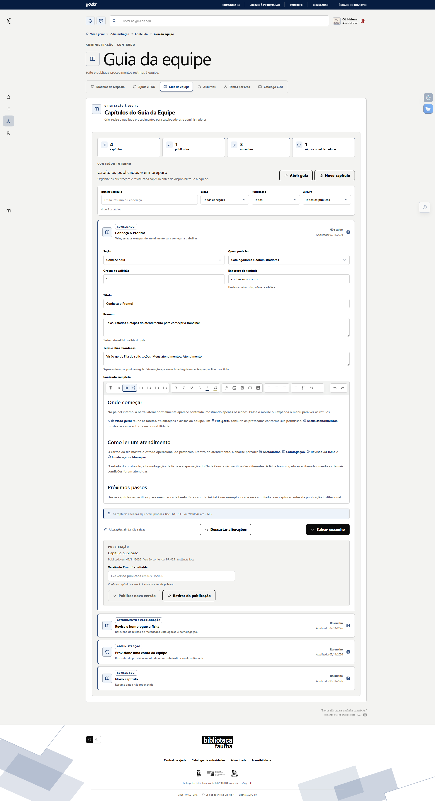

# Criar e publicar um capítulo do Guia da Equipe

**Estado editorial:** rascunho de 08/11/2026. Rótulos e condições conferidos na interface e nas regras da branch do PR #26. Falta percorrer o ciclo completo com conta administrativa fictícia e revisar o texto na versão instalada antes de publicar este procedimento para a equipe.

**Resultado:** um procedimento novo ou revisado passa a aparecer para a audiência escolhida no Guia da Equipe. **Para quem:** pessoa ativa com permissão **Editar e publicar guia**. Salvar um rascunho não altera a versão que a equipe lê.

## Elementos desta tarefa

| Elemento no Pronto! | O que faz |
| --- | --- |
| **Administração → Conteúdo → Guia da equipe** | Abre a edição dos capítulos internos. |
| **Novo capítulo** | Cria uma ficha editorial ainda não publicada. |
| **Seção** | Define o grupo que aparecerá no índice. |
| **Quem pode ler** | Limita a leitura a catalogadores e administradores ou somente administradores. |
| **Ordem de exibição** | Posiciona o capítulo dentro da seção. |
| **Endereço do capítulo** | Define a parte final do endereço; aceita minúsculas, números e hífens. |
| **Título** e **Resumo** | Identificam o capítulo na busca e na página inicial. |
| **Telas e abas abordadas** | Relaciona as interfaces reais tratadas no procedimento, separadas por ponto e vírgula; aparecem na visão de lista depois da publicação. |
| **Conteúdo completo** | Editor visual do texto, tabelas, links, imagens e referências a elementos do painel. |
| **Salvar rascunho** | Guarda a edição sem substituir o texto publicado. |
| **Versão do Pronto! conferida** | Registra em qual versão o procedimento foi verificado. |
| **Publicar capítulo** ou **Publicar nova versão** | Torna legível a versão salva para a audiência escolhida. |

No editor do Pronto!, as células da primeira coluna devem usar **Inserir elemento do painel** para apresentar o ícone e o nome oficiais quando disponíveis. Os campos sem ícone mantêm o rótulo exato.

## Passo a passo

1. No painel interno, abra **Administração → Conteúdo → Guia da equipe**. Use **Novo capítulo** para começar ou abra um cartão existente para revisá-lo.
2. Escolha a **Seção** e **Quem pode ler**. Para procedimentos de configuração ou acesso exclusivos de administradores, escolha **Somente administradores** antes de publicar.
3. Preencha **Título**, **Resumo**, **Endereço do capítulo** e **Ordem de exibição**. Um endereço já usado por outro capítulo não pode ser salvo.
4. Em **Telas e abas abordadas**, liste somente as interfaces atravessadas pela tarefa, com os nomes visíveis no painel. Separe cada uma por ponto e vírgula. Isso ajuda a pessoa a achar, na visão de lista, o que pode fazer na tela aberta.
5. Em **Conteúdo completo**, apresente o resultado e as condições para começar, uma tabela dos elementos usados, os passos, o resultado esperado e os impedimentos. Use **Inserir elemento do painel** para referências a telas, abas, ações e campos. Se uma etapa já está publicada em outro capítulo, use a incorporação expansível e confira se a audiência da origem permite a leitura.
6. Envie apenas capturas com dados fictícios plausíveis. O editor aceita PNG, JPEG e WebP de até 2 MB por imagem; o arquivo fica privado e exige acesso à página.
7. Selecione **Salvar rascunho**. Reabra o capítulo, revise a ordem, os links, as referências e a imagem no próprio guia. A equipe continua vendo a versão publicada anterior, se houver.
8. Depois de reproduzir o procedimento na versão instalada, preencha **Versão do Pronto! conferida** e selecione **Publicar capítulo** ou **Publicar nova versão**. Abra **Abrir guia** e confirme a visibilidade no índice, na busca e na visão de lista com cada perfil autorizado.

## Se algo precisar mudar

Uma edição salva em capítulo já publicado fica como **Alterações não publicadas** até **Publicar nova versão**. **Descartar alterações** restaura o último rascunho salvo, sem alterar a versão publicada. **Retirar da publicação** remove o capítulo da leitura da equipe e preserva seu rascunho; a ação exige confirmação. Se outro capítulo incorpora seu texto, confira também a leitura dessas caixas após mudar ou retirar a origem.

Toda alteração do Pronto! que afete um passo, rótulo, campo ou captura deste capítulo deve ser refletida no guia na mesma entrega, conforme o documento-mestre. O capítulo só deve declarar a versão efetivamente conferida.

## Conferência antes de publicar

- [ ] Executar criar, salvar, reabrir, publicar, alterar e retirar em conta administrativa fictícia.
- [ ] Confirmar a leitura por catalogador e administrador, inclusive a restrição de capítulos administrativos.
- [ ] Conferir imagem privada, busca, lista de telas abordadas e incorporação de tópico.
- [ ] Substituir esta captura de trabalho pela captura final da versão que será instalada.
