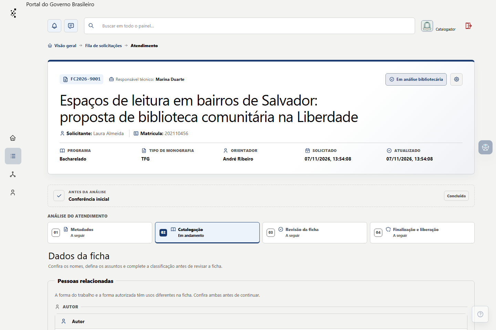

# Escolher assuntos controlados para uma ficha

**Estado editorial:** rascunho de 08/11/2026. Fluxo e rótulos conferidos no código da etapa **Catalogação** da branch do PR #26 e nas regras do documento-mestre. Falta reproduzir a seleção, a duplicidade e a homologação com um trabalho fictício na versão instalada; este capítulo não está publicado para a equipe.

**Resultado:** a ficha tem assuntos controlados em português, cada um com fonte registrada, e exatamente um assunto principal. **Para quem:** catalogador ou administrador com permissão de catalogar o protocolo atribuído. As palavras-chave do estudante são apoio para a análise, não cadastro controlado automático.

## Elementos desta tarefa

| Elemento no Pronto! | O que faz |
| --- | --- |
| **Atendimento → Catalogação → Assuntos controlados** | Reúne os termos usados na ficha. |
| **Fontes e critérios dos assuntos** | Abre os links das fontes documentárias e a orientação da escolha. |
| **Palavras-chave do estudante** | Mostra os termos livres enviados pelo estudante para consulta. |
| **Assunto 1**, **Assunto 2**, **Assunto 3** | Três posições iniciais. Outras podem ser acrescentadas pelo bibliotecário. |
| **Fonte** | Declara a fonte consultada para cada termo; deve ser escolhida antes de digitar o assunto. |
| **Termo preferido — português** | Busca a forma controlada no catálogo, inclusive por variantes. |
| **Equivalente — inglês (opcional)** | Registra a forma inglesa somente quando confirmada na fonte consultada. |
| **Termo principal** | Identifica um único assunto como principal para a ficha e para sugestões de CDU. |
| **Adicionar termo** | Cria uma posição adicional quando a análise precisar de mais de três assuntos. |
| **Importar autoridade** e **Cadastrar assunto local** | Surgem depois de uma busca sem correspondência, conforme fonte e permissão; cada opção exige procedimento próprio. |

No editor do guia, use **Inserir elemento do painel** para a primeira coluna: o pictograma e o rótulo devem ser os mesmos da interface. Não represente como termo aprovado um cadastro que ainda aguarda revisão.

## Passo a passo

1. Abra o protocolo em **Meus atendimentos** e escolha a etapa **Catalogação**. Em **Assuntos controlados**, leia as **Palavras-chave do estudante** e o assunto do trabalho completo. Use essa informação para formular possibilidades, sem copiá-la automaticamente para a ficha.
2. Abra **Fontes e critérios dos assuntos**. Consulte a fonte apropriada para o conceito e a forma autorizada. Em cada posição **Assunto**, escolha primeiro **Fonte**; somente então o campo **Termo preferido — português** fica disponível.
3. Digite parte do termo em **Termo preferido — português** e aguarde os resultados da busca completa. A lista pode encontrar uma variante e mostrar o termo preferido correspondente. Leia forma, fonte, situação e tipo antes de selecionar. Uma grafia parecida não basta para afirmar equivalência conceitual.
4. Selecione o cadastro existente apropriado. Confira a fonte registrada naquela posição e, se a fonte realmente confirmar uma forma inglesa, preencha **Equivalente — inglês (opcional)**. Caso contrário, deixe o campo vazio.
5. Repita a análise até ter pelo menos três assuntos controlados em português. Use **Adicionar termo** se precisar de mais. Ordene as posições pela relevância e marque exatamente um **Termo principal**.
6. Antes de seguir à revisão da ficha, confira duplicidades, assunto inativo ou ainda **Aguardando revisão**, fontes de cada posição e o termo principal. O sistema impede a homologação quando os requisitos não estão satisfeitos; resolva o motivo indicado sem presumir que a sugestão do sistema validou o termo.

## Se o termo não aparecer

Espere o fim da busca e revise a grafia e as variantes. A ação **Importar autoridade** aparece somente após busca concluída sem resultados no catálogo completo, e não quando a busca falha. **Cadastrar assunto local** não cria automaticamente um termo aprovado: uma proposta pode ficar inativa e indisponível para novas fichas até revisão e ativação. Use os capítulos específicos de importação e cadastro antes de voltar a esta tarefa.

Se a busca apresentar erro, a interface permite tentar novamente e mantém o preenchimento manual, mas não há confirmação de inexistência na base. Não conclua que é necessário importar uma autoridade enquanto a consulta completa não estiver disponível.

## Conferência antes de publicar

- [ ] Capturar **Assuntos controlados**, a fonte aberta, resultados por termo e por variante, termo principal e aviso de pendência com dados fictícios plausíveis.
- [ ] Testar três termos ativos distintos, um termo adicional, reordenação e remoção de posição adicional.
- [ ] Testar ausência de fonte, duplicidade, dois ou nenhum termo principal e proposta inativa.
- [ ] Confirmar a decisão bibliotecária sobre a fonte e a forma, sem usar sugestões automáticas como validação.
- [ ] Registrar **Fila de solicitações; Meus atendimentos; Atendimento · Catalogação; Revisão da ficha** em **Telas e abas abordadas**.
