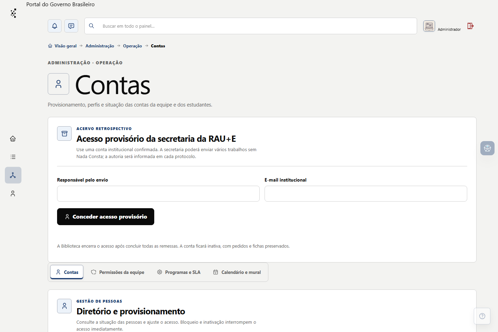
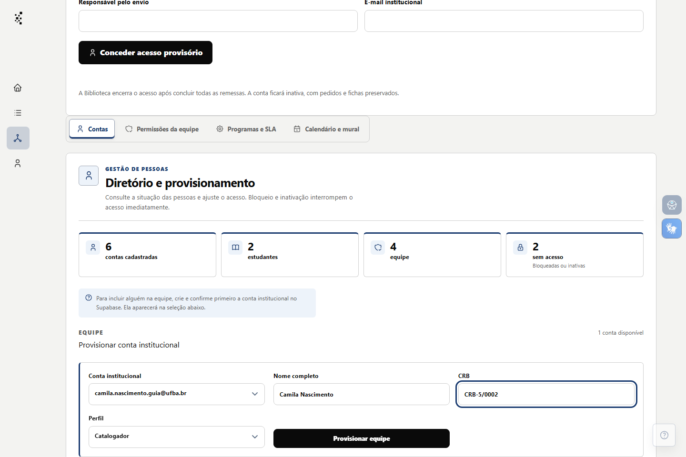
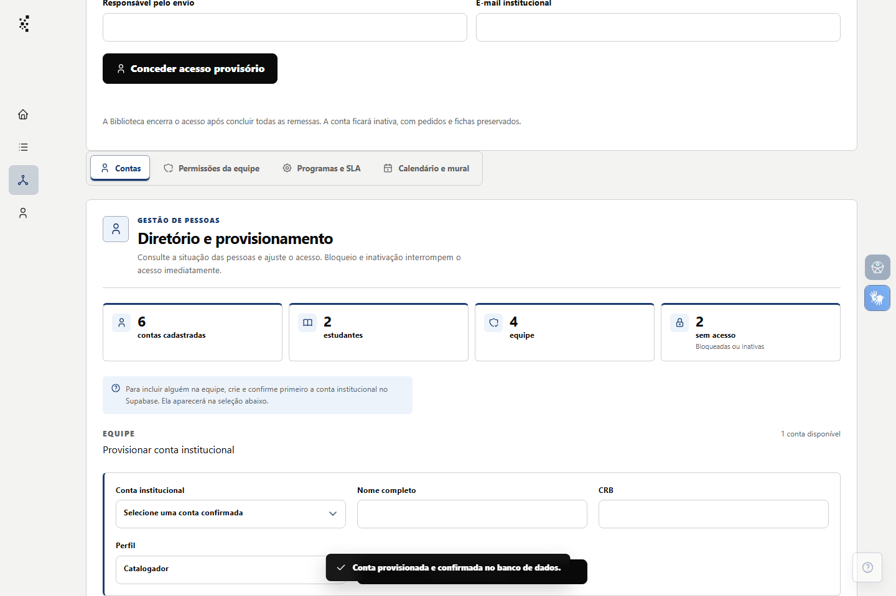

# Provisionar uma conta da equipe

**Estado editorial:** rascunho de 08/11/2026, baseado no fluxo do painel e nas capturas sintéticas do piloto. A decisão de conceder o perfil profissional ou administrativo depende da atribuição institucional; o texto e as imagens ainda precisam de conferência na versão instalada antes da publicação.

**Resultado:** uma conta institucional já criada e confirmada recebe perfil de **Catalogador** ou **Administrador** no Pronto!. **Para quem:** administrador ativo com permissão **Provisionar equipe**. O e-mail informado no painel não cria uma conta de autenticação e não substitui a confirmação institucional.

## Elementos desta tarefa

| Elemento no Pronto! | O que faz |
| --- | --- |
| **Administração → Operação → Contas** | Abre a gestão de contas e o diretório. |
| **Diretório e provisionamento** | Mostra os perfis existentes e o formulário de entrada da equipe. |
| **Provisionar conta institucional** | Identifica a operação para uma conta de autenticação já confirmada. |
| **Conta institucional** | Seleciona uma conta elegível ainda sem perfil da equipe. |
| **Nome completo** | Registra o nome que aparecerá no painel. |
| **CRB** | Registra o número profissional quando aplicável. |
| **Perfil** | Define **Catalogador** ou **Administrador** conforme a decisão institucional. |
| **Provisionar equipe** | Confirma a criação do perfil operacional. |

Na versão editada no Pronto!, a primeira coluna deve usar **Inserir elemento do painel** para associar os nomes e ícones oficiais. Campos sem pictograma mantêm o rótulo exato.

## Passo a passo

1. Confirme que a conta institucional da pessoa já foi criada e teve o e-mail confirmado. No painel, abra **Administração → Operação → Contas** e localize **Diretório e provisionamento → Provisionar conta institucional**.
2. Em **Conta institucional**, selecione a conta correta. Confira nome e e-mail antes de seguir. O painel não pede UUID nem senha. Se a lista estiver vazia, não há conta confirmada elegível nessa seleção.
3. Preencha **Nome completo** e **CRB**. Escolha **Catalogador** ou **Administrador** em **Perfil** somente após conferir a atribuição aprovada para a pessoa.
4. Revise o conjunto de dados e selecione **Provisionar equipe**. Espere a confirmação do sistema e confira a pessoa no diretório depois da atualização.
5. Se a pessoa precisar de uma permissão específica, trate-a no procedimento de **Permissões da equipe**. Bloqueio ou inativação retiram o acesso operacional; o provisionamento não deve ser usado para contornar um desses estados.

## Se a conta ou a seção não aparecer

Confira se a conta administrativa está ativa e se tem a permissão **Provisionar equipe**. Se a conta desejada não estiver em **Conta institucional**, confirme a existência e a verificação do e-mail no serviço de autenticação pelos responsáveis autorizados. Não copie identificadores diretamente para o formulário nem crie um segundo perfil para contornar uma situação de bloqueio.

## Conferência antes de publicar

- [ ] Reproduzir a entrada completa com conta fictícia confirmada e administrador com a permissão necessária.
- [ ] Conferir as opções do campo **Perfil** e o estado final da pessoa no diretório.
- [ ] Testar a ausência da seção para perfil sem permissão e a lista vazia de contas elegíveis.
- [ ] Confirmar com a BIB/FAUFBA o critério de autorização para perfil **Administrador**.
- [ ] Registrar **Administração; Operação; Contas** em **Telas e abas abordadas** e capturar a versão efetivamente instalada.
