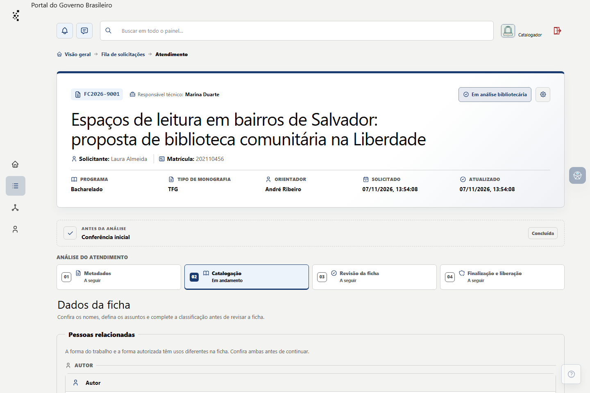
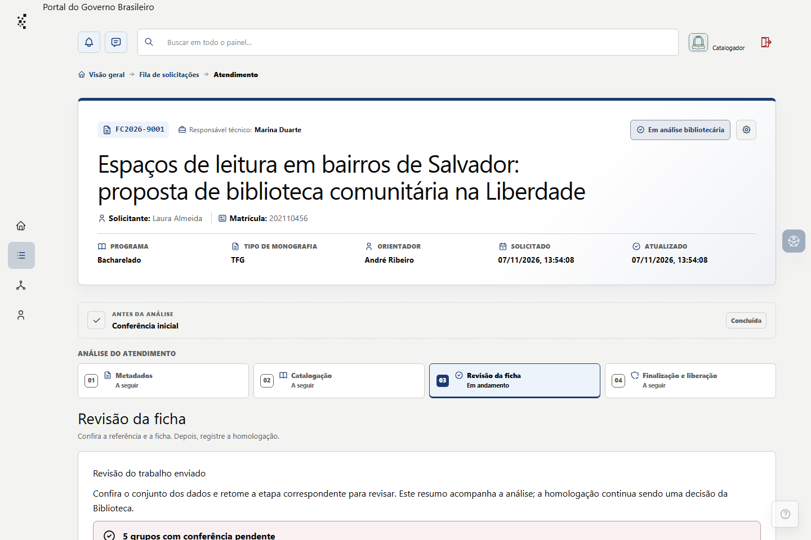
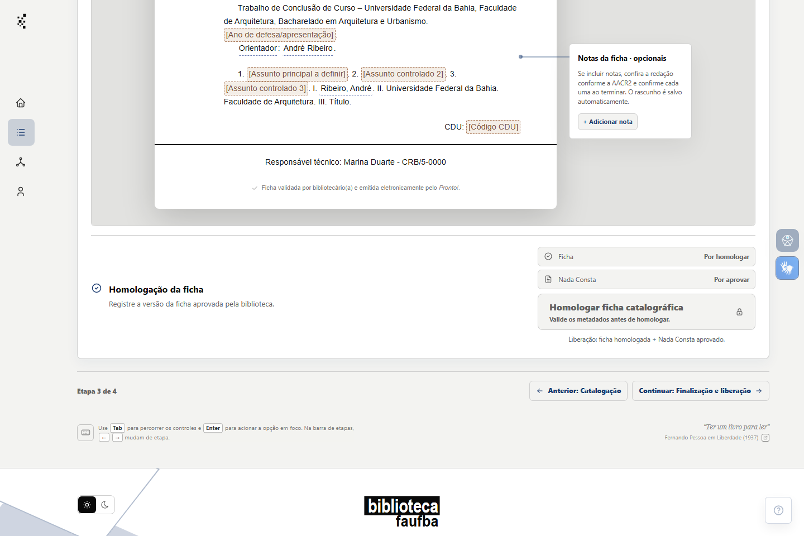

# Revisar e homologar uma ficha catalográfica

**Estado editorial:** rascunho de 08/11/2026, baseado no fluxo e nos rótulos da branch do PR #26. A sequência de preparação e homologação ainda precisa ser concluída com dados fictícios na instância local e conferida na versão instalada. Este capítulo não está publicado para leitura da equipe.

**Resultado:** a ficha do protocolo fica homologada. A liberação para o estudante depende também de **Nada Consta** aprovado. **Para quem:** catalogador ou administrador ativo com permissão de análise e protocolo atribuído.

## Elementos desta tarefa

| Elemento no Pronto! | O que faz |
| --- | --- |
| **Meus atendimentos** | Localiza o protocolo sob sua responsabilidade. |
| **Metadados** | Mostra os dados enviados e a conferência inicial. |
| **Validar metadados e seguir? → Confirmar validação** | Registra a revisão e libera a etapa de catalogação quando não há impedimento. |
| **Catalogação** | Reúne nomes, assuntos, fontes e dados técnicos usados na ficha. |
| **Revisão da ficha** | Apresenta referência, prévia, PDF e impedimentos da homologação. |
| **Referência do trabalho → Validar referência** | Registra a conferência do texto da referência; uma alteração posterior exige nova validação. |
| **Conferi os nomes, a descrição física, os assuntos, a CDU, o Cutter e o conteúdo da ficha.** | Confirma que a pessoa responsável revisou todos os elementos antes da decisão. |
| **Homologar ficha catalográfica → Confirmar homologação** | Registra a decisão final; o diálogo informa se a liberação ainda aguarda o Nada Consta. |
| **Finalização e liberação** | Mostra o estado do Nada Consta e a condição de entrega da ficha. |

No editor do guia, insira as referências dessa tabela pelo seletor **Inserir elemento do painel**, com os pictogramas reais quando houver. Rótulos de campos e diálogos sem pictograma aparecem pelo nome exato.

## Antes da homologação

1. Em **Meus atendimentos**, abra o protocolo. Confirme número, estudante, título e estado para não agir em outro trabalho com nome semelhante.
2. Em **Metadados**, compare o cadastro com o trabalho completo indicado pelo estudante. Se houver erro corrigível, marque o campo, registre a orientação e solicite a correção. Depois do reenvio, confira os valores novos. Se não houver pendências, use **Validar metadados e seguir? → Confirmar validação**.
3. Em **Catalogação**, confira a forma autorizada dos nomes, os assuntos controlados, a fonte de cada termo, a CDU, o Cutter e a descrição física. Resolva as pendências mostradas na tela; sugestões do sistema não substituem a decisão bibliotecária.

## Revisar e homologar

4. Abra **Revisão da ficha**. Em **Referência do trabalho**, ajuste o texto quando necessário e selecione **Validar referência**. Se algum dado que compõe a referência for alterado depois, use **Revalidar referência**.
5. Leia a ficha na prévia e abra a versão em PDF. Confira nomes, título, descrição, assuntos, CDU, Cutter, quebras e conteúdo final. Resolva todos os bloqueios apresentados na própria etapa antes de prosseguir.
6. Marque **Conferi os nomes, a descrição física, os assuntos, a CDU, o Cutter e o conteúdo da ficha.** Selecione **Homologar ficha catalográfica**. No diálogo **Homologar esta ficha?**, confira o efeito informado e escolha **Confirmar homologação**.
7. Confira o resultado da homologação. Se o **Nada Consta** ainda está **Por aprovar**, a ficha permanece aguardando essa aprovação para ser liberada ao estudante. Continue o protocolo pela etapa **Finalização e liberação**.

## Se a ação estiver indisponível

Leia o motivo no próprio botão ou no aviso da etapa. Complete os campos e validações pendentes antes de tentar de novo. Uma referência alterada depois da validação deve ser revalidada. Um assunto local pendente de revisão não deve ser tratado como assunto controlado ativo. Se o estudante reenviou metadados, a nova informação precisa de conferência profissional.

## Conferência antes de publicar

- [ ] Reproduzir o fluxo inteiro, incluindo referência validada, ficha completa, PDF e confirmação, com dados fictícios plausíveis.
- [ ] Capturar os estados após a homologação e após a aprovação do Nada Consta, sem dados pessoais reais.
- [ ] Confirmar os critérios de assuntos, fonte, CDU e Cutter no procedimento vigente e na interface instalada.
- [ ] Testar um impedimento real e a revalidação da referência depois de uma alteração.
- [ ] Registrar **Meus atendimentos; Atendimento · Metadados; Catalogação; Revisão da ficha; Finalização e liberação** em **Telas e abas abordadas**.
